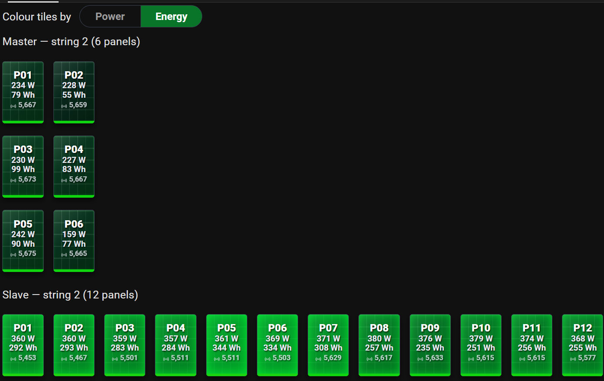
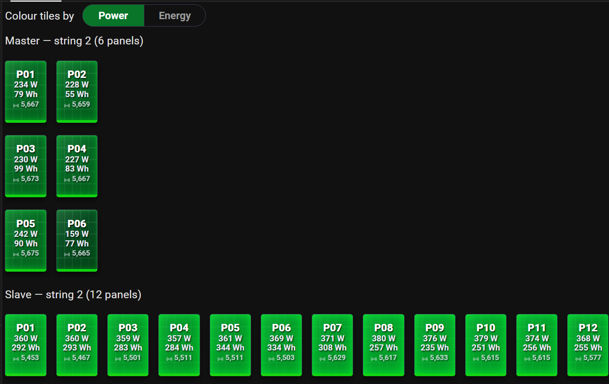
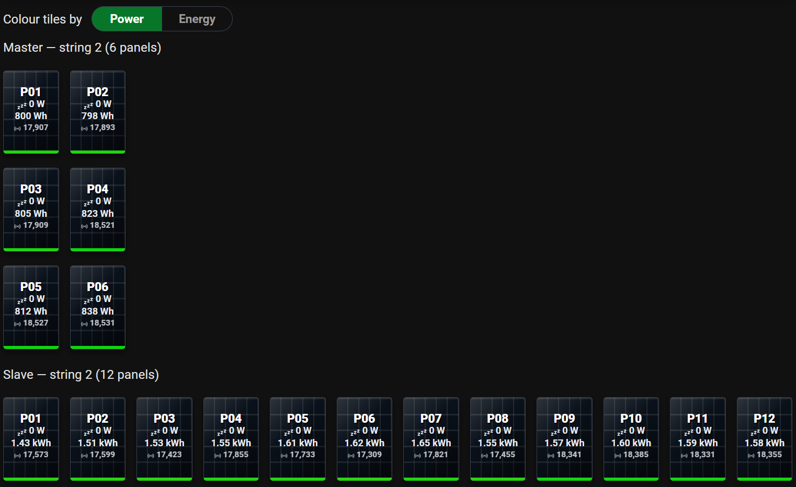

# PyTap

**Local monitoring of Tigo TS4 optimizers in Home Assistant, without Tigo's cloud.** PyTap listens to the RS-485 bus between your Tigo CCA and its TAP and gives every panel its own live sensors: power, voltage, current, temperature, energy and health.

> An unofficial community integration, not affiliated with or endorsed by Tigo Energy. An independently maintained fork of [azebro/pytap](https://github.com/azebro/pytap) by Adam Zebrowski, who built the integration. See the [changelog](https://github.com/DoubleDoc/pytap/blob/main/CHANGELOG.md) for what differs and [credits](#credits) for everyone whose work it includes.

<table>
  <tr>
    <td width="33%"></td>
    <td width="33%"></td>
    <td width="33%"></td>
  </tr>
  <tr>
    <td>Coloured by power</td>
    <td>At night: asleep at 0 W, the day's totals kept</td>
    <td>Classic PV Production: readings per panel today</td>
  </tr>
</table>

## What you get

- **Every panel, live.** 13 sensors per optimizer (power, voltages, currents, temperature, duty cycle, signal, daily and lifetime energy, performance), totals per string, inverter and gateway, and Energy dashboard ready. [Entities →](https://github.com/DoubleDoc/pytap/blob/main/docs/entities.md)
- **Quick setup, painless maintenance.** Optimizers are found automatically. Entity IDs are the optimizer's barcode, so moving panels between strings or inverters, or renaming them, never breaks dashboards or history. [Configuration →](https://github.com/DoubleDoc/pytap/blob/main/docs/configuration.md)
- **Numbers you can trust.** Each panel's data validity, sun-aware night handling, estimates for briefly silent panels, and physically impossible readings thrown out. [When readings stop →](https://github.com/DoubleDoc/pytap/blob/main/docs/readings.md)
- **Health at a glance.** Bus status per gateway, and per-panel status flags decoded from every report. [Status flags →](https://github.com/DoubleDoc/pytap/blob/main/docs/entities.md#status-flags-and-reading-faults)
- **Local and listen-only.** Nothing is sent on the bus, so the CCA and Tigo's cloud keep working as before. Connect with an RS-485 to TCP converter, a serial adapter or an ESPHome serial proxy. [Hardware →](https://github.com/DoubleDoc/pytap/blob/main/docs/hardware.md)
- **Light on your database.** Readings are averaged (60 s by default) and rounded, and flags are written only when they change. [Reporting modes →](https://github.com/DoubleDoc/pytap/blob/main/docs/configuration.md#reporting-modes)
- **Research tools.** Record the raw bus on demand and replay it offline through PyTap's own parser. [Packet capture →](https://github.com/DoubleDoc/pytap/blob/main/docs/capture.md)
- **Ready-made dashboards.** [PV Panels](https://github.com/DoubleDoc/pytap/blob/main/dashboards/pv_panels.md), one view of the whole roof, and the classic [PV Production](https://github.com/DoubleDoc/pytap/blob/main/dashboards/pv_production.md) views, with a Grafana version.

## Quick start

You need Home Assistant 2026.11 or later and a Tigo CCA with its TAP(s) and TS4 optimizers.

1. **Connect to the bus.** Wire an RS-485 to TCP converter (for example a Waveshare RS485 to Ethernet), a serial RS-485 adapter or an ESPHome serial proxy to the CCA's GATEWAY A and B terminals. [Hardware and wiring →](https://github.com/DoubleDoc/pytap/blob/main/docs/hardware.md)
2. **Install.** In **Settings → Marketplace**, select **Add from link**, enter `DoubleDoc/pytap`, install **PyTap** and restart Home Assistant. [Installation →](https://github.com/DoubleDoc/pytap/blob/main/docs/installation.md)
3. **Add the integration.** **Settings → Devices & services → Add integration → PyTap**, choose your connection, and select **Finish setup**: discovery adds your optimizers. [Configuration →](https://github.com/DoubleDoc/pytap/blob/main/docs/configuration.md)
4. **Wait for sunrise.** PyTap learns which optimizer is which when the optimizers power up in the morning; after that, readings flow and restarts resolve straight away. [First start →](https://github.com/DoubleDoc/pytap/blob/main/docs/configuration.md#first-start-what-to-expect)

## Documentation

| | |
| --- | --- |
| [Hardware](https://github.com/DoubleDoc/pytap/blob/main/docs/hardware.md) | Ways to connect, wiring, Waveshare converter settings |
| [Installation](https://github.com/DoubleDoc/pytap/blob/main/docs/installation.md) | Marketplace, manual, upgrading, removing |
| [Configuration](https://github.com/DoubleDoc/pytap/blob/main/docs/configuration.md) | Setup, discovery, the first morning, managing modules, reporting modes |
| [Entities and devices](https://github.com/DoubleDoc/pytap/blob/main/docs/entities.md) | Sensors, status flags, totals, bus status, device naming, Energy dashboard |
| [When readings stop](https://github.com/DoubleDoc/pytap/blob/main/docs/readings.md) | Night, dropouts, stale-reading settings, estimates, data validity |
| [Dashboards](https://github.com/DoubleDoc/pytap/blob/main/dashboards/pv_panels.md) | PV Panels; also [PV Production](https://github.com/DoubleDoc/pytap/blob/main/dashboards/pv_production.md) and Grafana |
| [Troubleshooting](https://github.com/DoubleDoc/pytap/blob/main/docs/troubleshooting.md) | Diagnostics, log messages, debug logging, known limitations |
| [Packet capture](https://github.com/DoubleDoc/pytap/blob/main/docs/capture.md) | Recording the bus, deleting captures, offline tools |
| [Protocol status bits](https://github.com/DoubleDoc/pytap/blob/main/docs/protocol-status-bits.md) | What each flag bit means, and the evidence |
| [How it works](https://github.com/DoubleDoc/pytap/blob/main/docs/how-it-works.md) | Data flow, and future work |
| [Development](https://github.com/DoubleDoc/pytap/blob/main/docs/development.md) | Project layout, tests, linting, deploying |
| [Changelog](https://github.com/DoubleDoc/pytap/blob/main/CHANGELOG.md) | Every release |

Questions and problems: [open an issue](https://github.com/DoubleDoc/pytap/issues).

## Credits

<table>
  <tr>
    <td align="center" width="16%"><a href="https://github.com/azebro"> <b>Adam Zebrowski</b></a> Wrote PyTap</td>
    <td align="center" width="16%"><a href="https://github.com/timlaing"> <b>Tim Laing</b></a> Reliability, serial, discovery, capture, status (#32–#39)</td>
    <td align="center" width="16%"><a href="https://github.com/poolski"> <b>Kyrill</b></a> Averaged reporting</td>
    <td align="center" width="16%"><a href="https://github.com/seaosair"> <b>seaosair</b></a> Database load</td>
    <td align="center" width="16%"><a href="https://github.com/willglynn"> <b>Will Glynn</b></a> taptap: the protocol</td>
    <td align="center" width="16%"><a href="https://github.com/Bobsilvio"> <b>Bobsilvio</b></a> Protocol notes</td>
  </tr>
</table>

What each contributed, in detail: [Credits](https://github.com/DoubleDoc/pytap/blob/main/docs/credits.md).

## License

[MIT](https://github.com/DoubleDoc/pytap/blob/main/LICENSE). © Adam Zebrowski; © Tim Laing for his adopted contributions; © DoubleDoc for the fork's changes.
