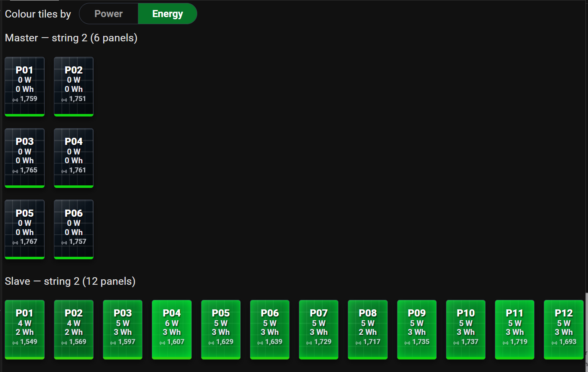
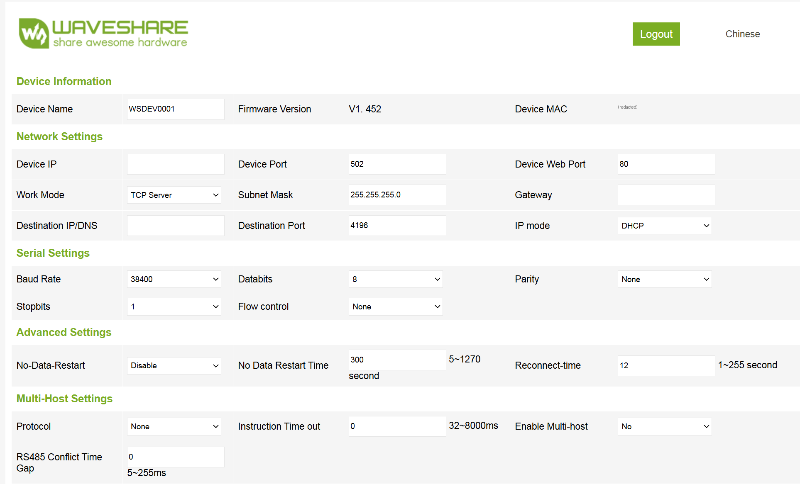

# PyTap

[](LICENSE)
[](https://www.home-assistant.io/)
[](https://hacs.xyz/)
[](https://github.com/DoubleDoc/pytap/actions/workflows/validate.yml)

A Home Assistant custom integration for monitoring **Tigo TS4 optimizers** locally, without Tigo's cloud. PyTap listens to the RS-485 bus between a Tigo CCA and its TAP through an RS-485 to TCP converter, and exposes real-time per-optimizer sensors: power, voltage, current, temperature, energy and more.

## See every panel at once



This fork comes with the **[PV Panels dashboard](dashboards/pv_panels.md)**: one view with every panel laid out like your roof. Each tile shows:

- **live power**, or the panel's state when it isn't reporting normally (`Asleep`, `Est.`, `Silent`, `No data`);
- **today's energy**;
- **today's readings count**, plus a red-to-green connectivity bar along its bottom edge.

A **Colour tiles by [Power | Energy]** switch picks what the tile colour shows. Problem panels stand out in either mode: estimated panels are amber, silent ones red, and panels with no data grey. These states come from this fork's per-panel [Data validity](#sensors) sensor.

The tiles are driven by two shared templates, so adapting the dashboard to your roof means editing one line per panel. See [`dashboards/pv_panels.md`](dashboards/pv_panels.md) to set it up. The original three-view [PV Production dashboard](dashboards/pv_production.md) is still included and maintained.

---

## Hardware requirements

PyTap needs an **RS-485 to TCP converter** connected to the bus between your Tigo CCA and its TAP(s). PyTap only listens: it never transmits, so the CCA and Tigo's cloud keep working as before. For background on the bus and other ways to connect, see [taptap](https://github.com/willglynn/taptap#connecting).

You need one converter, and one PyTap entry, per CCA.

### Wiring

Connect the converter to the CCA's **GATEWAY** terminals, the same ones the TAP uses:

| CCA GATEWAY terminal | Converter terminal |
| --- | --- |
| A | A (sometimes labelled A+ or 485+) |
| B | B (sometimes labelled B- or 485-) |
| – (ground) | GND, if the converter has one |
| + | **Not connected.** This powers the TAPs; power the converter from its own supply or PoE. |

- Keep the converter's wires short, or move the CCA's A and B wires to the converter and run new wires from it to the CCA.
- The bus is already terminated at the CCA and at the last TAP. If your converter has a termination resistor (a jumper, DIP switch or setting, usually 120 Ω), **turn it off**.

### Example: Waveshare RS485 to Ethernet converter

Waveshare's RS485-to-Ethernet converters work well. Open the converter's web page (its IP address in a browser) and set:

| Setting | Value | Why |
| --- | --- | --- |
| Work Mode | **TCP Server** | PyTap connects to the converter. |
| Device Port | **502** | PyTap's default port. Any port works if you enter the same one in PyTap. |
| IP mode | DHCP with a reservation on your router, or Static | PyTap connects by address, so it must not change. |
| Destination IP/DNS, Destination Port | (ignored) | Only used in client modes. |
| Baud Rate | **38400** | Speed of the Tigo gateway bus. |
| Databits / Parity / Stopbits | **8 / None / 1** | |
| Flow control | **None** | |
| No-Data-Restart | **Disable** | PyTap reconnects by itself when data stops. |
| Protocol | **None** | Raw passthrough. Modbus conversion would corrupt the Tigo frames. |
| Enable Multi-host | **No** | |



When you add PyTap, enter the converter's IP address as the **host** and its Device Port as the **port**.

## Features

- **Real-time streaming** — Push-based data delivery with sub-second latency (no polling).
- **Configurable reporting** — Choose a **time-weighted averaged interval** (default for new entries, every 60 seconds) that caches readings and pushes a single representative value to reduce CPU and recorder load, or **live reporting** (every reading delivered as it arrives).
- **Per-optimizer sensors** — 13 sensor entities per Tigo TS4 module: performance,
  power, voltage in/out, current in/out, temperature, DC-DC duty cycle, RSSI,
  daily energy, total energy, readings today and data validity.
- **Aggregate sensors** — 4 sensors per string and 4 per gateway total: performance, power, daily energy, total energy.
- **Performance tracking** — Per-optimizer, per-string and per-gateway performance percentage based on configurable peak panel power (Wp).
- **Diagnostics download** — Integration diagnostics export includes parser counters, infrastructure/mapping state, and per-node summaries.
- **Menu-driven setup** — Add optimizer modules one at a time with guided form fields.
- **Barcode-based identification** — Stable hardware barcodes as entity identifiers (survives gateway restarts).
- **Discovery logging** — Unconfigured barcodes seen on the bus are logged for easy identification.
- **Persistent barcode mapping** — Discovered barcodes and node mappings are
    saved across restarts. When you add a previously-discovered barcode,
    it resolves instantly without waiting for the next gateway enumeration.
- **Restart-safe availability** — Last known node readings are persisted and
    restored on startup, so sensors stay available with the most recent value
    even before the first live frame arrives (for example after a night restart).
- **Night and dropout handling** — Live readings go to 0 when the optimizers fall asleep at night, and become unavailable only after a long daytime silence or when the converter stops sending data (see [When readings go to 0 or unavailable](#when-readings-go-to-0-or-unavailable)).
- **Estimating silent optimizers** — While an optimizer is silent but the rest of its string is producing normally, the String and Total devices use an estimate based on its usual share of the string, including the energy it produced while silent. Its own sensors only ever show what it reported (see [Estimating silent optimizers](#estimating-silent-optimizers)).
- **Data validity sensor** — Per optimizer: reporting, holding last value, estimated, asleep or silent.
- **Bus status sensor** — Per gateway: normal, RS-485 converter unreachable, or bus quiet (CCA off or wiring), so an outage points at the right box.
- **Energy accumulation** — Trapezoidal Wh integration with proactive midnight reset and monotonic lifetime totals. Daily sensors zero at exactly midnight local time.
- **No external dependencies** — The protocol parser library is fully embedded; nothing to install from PyPI.
- **Options flow** — Add, edit or remove optimizer modules and rename strings at any time without reconfiguring.
- **Structured device names** — `Tigo [inverter] [string] [module]`, with an optional inverter name for installations with more than one gateway (see [Device naming](#device-naming)).
- **Node mapping sensor** — Shows whether readings can be matched to your modules yet, so a new installation that is still waiting for its first node table is visibly working (see [First start: what to expect](#first-start-what-to-expect)).

## Sensors

Each configured Tigo TS4 optimizer exposes the following sensors:

| Sensor | Unit | Device Class |
| --- | --- | --- |
| Performance | % | — |
| Power | W | `power` |
| Voltage In | V | `voltage` |
| Voltage Out | V | `voltage` |
| Current In | A | `current` |
| Current Out | A | `current` |
| Temperature | °C | `temperature` |
| DC-DC Duty Cycle | % | — |
| RSSI | dBm | `signal_strength` |
| Daily Energy | Wh | `energy` |
| Total Energy | Wh | `energy` |
| Readings Today | — | — (diagnostic) |
| Data validity | — | `enum` (diagnostic): see below |

PyTap also creates aggregate virtual devices:

- **Tigo [inverter] String <name>** — `performance`, `power`, `daily_energy`, `total_energy`. Created for every string, even when there is only one, so a string keeps its history when more strings are added later.
- **Tigo [inverter] Total** — `performance`, `power`, `daily_energy`, `total_energy`, plus two diagnostic sensors: **Node mapping** (whose `silent_modules` attribute lists silent modules) and **Bus status** (see below).

On each device page these sensors are simply called **Power**, **Performance**, **Daily energy** and **Total energy**; the device name tells them apart (full names such as *Tigo Master String 2 Power* and *Tigo Master Total Power*). "Total" therefore means two things: the **Total device** (the whole gateway) and the **Total energy** sensor (lifetime energy), which on the Total device is named *Tigo … Total Total energy*. This README says "the String and Total devices" for the sums, and "Total energy" only for lifetime energy.

### Bus status

Each gateway (each PyTap entry, i.e. each CCA) has a **Bus status** sensor on its Total device. The Tigo CCA polls its optimizers around the clock, so the bus is never quiet in normal operation, even at night. If no data arrives for 5 minutes, PyTap can't tell anything about any optimizer on that gateway, so **every optimizer's live readings and Data validity become unavailable** until data returns. Energy totals are kept.

| State | Meaning | Check |
| --- | --- | --- |
| Normal | Data is arriving from the bus. | — |
| RS-485 converter unreachable | The TCP connection to the converter fails or keeps dropping. | The converter's power, network cable or Wi-Fi, IP address and port. |
| Bus quiet | The converter accepts the connection but has nothing to forward. | That the Tigo CCA is powered and running, and the converter's A/B wiring to the CCA's gateway bus. |

While the status isn't normal, the `last_data` attribute shows when data last arrived.

### When readings go to 0 or unavailable

Optimizers stop reporting when it gets dark, and by day one can drop off the radio link to the TAP for a while (2.4 GHz interference) and come back by itself. PyTap therefore treats silence differently depending on the sun's position, which it works out from your Home Assistant location:

| Situation | Live readings | Energy and Readings Today |
| --- | --- | --- |
| Reporting | Latest values | Counting |
| Sun below 10° and no report for 10 minutes (asleep) | Power, voltage, current, performance and duty cycle read **0**; temperature and RSSI keep their last value | Kept |
| Daylight, no report yet since the optimizers went to sleep | Stay at 0 | Kept |
| Daylight, no report for **30 minutes** (silent) | **Unavailable**, and a warning is logged | Kept |
| Bus status not normal: no data from the bus for 5 minutes | **Unavailable** for every optimizer on that gateway, and a warning is logged | Kept |

Short daytime gaps keep the last value, so a brief radio dropout doesn't zero a panel or break its history. If Home Assistant has no location set, PyTap never assumes it is night.

These rules apply to each optimizer's own sensors. For the String and Total devices, see the next section.

### Estimating silent optimizers

An optimizer that stops reporting hasn't necessarily stopped producing. The optimizers in a string are wired in series and carry the same current, so if the rest of the string is producing normally, the silent one likely is too; it just isn't being heard. If it fails in a way that breaks the string, the others may show it, because the string's current might drop.

PyTap uses this on the String and Total devices:

1. **Learning each optimizer's share.** While an optimizer and the rest of its string are reporting, PyTap keeps a rolling average (over roughly the last 10 minutes) of its power divided by the average power of the others in its string. This captures shading: a panel that is shaded in the afternoon has a share below 1 at that time.
2. **Estimating.** Once an optimizer has been quiet for 2 minutes, and at least half of the other optimizers in its string are reporting, its estimated power is its share × their current average. If no share has been learned yet, it is assumed to produce the average.
3. **Estimated energy.** The estimated power is added up as *estimated energy* from its last report until it reports again, and checked every minute. A gap of 2–3 minutes that ends before the next check is bridged with the average of the optimizer's own readings either side of it, also counted as estimated energy. (Optimizers report power, not energy: PyTap adds up energy from readings no more than 120 s apart, so without this such a gap would be lost.)

| | Optimizer's own sensors | String and Total devices |
| --- | --- | --- |
| Power | What it reported (held, then 0 or unavailable as above) | The estimate while one is available |
| Daily and total energy | **Only what it reported** | What all optimizers reported **plus** estimated energy |

So a string's energy can be slightly more than the sum of its optimizers' energy sensors, by exactly the string's `estimated_energy` attribute. The **Power** sensors on the String and Total devices have an `estimated_count` attribute showing how many optimizers are being estimated right now, and `reporting_count` showing how many reported within the last 2 minutes (Data validity *Reporting*; asleep, holding, estimated and silent optimizers aren't counted).

Estimating needs neighbours: an optimizer that is alone in its string, or without a string, is never estimated, and nothing is estimated when fewer than half of the others in its string are reporting (for example at night). A silent optimizer without an estimate is left out of the String and Total devices' **Power** until it reports again.

**Turning it off.** Untick **Estimate silent optimizers** under **Configure → Change reporting settings**. The String and Total devices then hold a silent optimizer's last reported power instead, and no energy is added for the time it was silent. Energy already estimated stays in the lifetime totals, since those can't go down.

#### Data validity sensor

Each optimizer has a diagnostic **Data validity** sensor that shows how much its current readings can be trusted:

| State | Meaning |
| --- | --- |
| Reporting | Readings received within the last 2 minutes. |
| Holding last value | Quiet for more than 2 minutes; its sensors hold the last values, and no estimate is possible (or estimating is off). |
| Estimated from string | Quiet for less than 30 minutes; the String and Total devices are using an estimate from the rest of its string. Its own sensors hold the last values. |
| Silent, estimated in string | Quiet for 30 minutes or more in daylight. Its own live readings are unavailable, but the rest of its string is producing, so the String and Total devices still use an estimate. A long dropout like this usually means a weak radio link to the TAP. |
| Asleep | Night: live readings read 0. |
| Silent | Quiet for 30 minutes in daylight with no estimate; live readings are unavailable. |

While the gateway's [Bus status](#bus-status) isn't normal, Data validity is unavailable too: the problem is the whole gateway, not the optimizer.

Its attributes show the learned share of the string average (to the nearest 0.05), the energy estimated for it today and, once it has stopped reporting, `last_report`: when it last reported. The optimizer's other sensors have no per-reading timestamp attribute: one that changes with every reading would make Home Assistant write a database row on every reading even when the value hasn't changed. A panel that often shows *Estimated*, *Silent, estimated in string* or *Silent* has a weak radio link to the TAP.

### Device naming

Device names are built from up to three levels, leaving out any that aren't set:

| Level | Set in | Example |
| --- | --- | --- |
| Inverter | Optional per gateway: **Inverter name** | `Master` |
| String | Each module's **String group** | `2` (numbers are shown as `S2`) or `East` |
| Module | Each module's **Name**, usually its position | `P01` |

| Device | One gateway (no inverter name) | Two gateways (`Master`, `Slave`) |
| --- | --- | --- |
| Optimizer | `Tigo S2 P01` | `Tigo Master S2 P01` |
| String total | `Tigo String 2` | `Tigo Master String 2` |
| Gateway total | `Tigo Total` | `Tigo Master Total` |

Most installations have one CCA and one PyTap entry, and can leave the inverter name blank. With more than one CCA (for example one per inverter), add one PyTap entry per gateway and give each an inverter name so their devices don't share names.

Entity IDs are generated from the device names when entities are first created, for example `sensor.tigo_master_s2_p01_power`. If the device is in an area, recent Home Assistant versions may put the area name first (`sensor.outside_tigo_master_s2_p01_power`). Home Assistant doesn't change existing entity IDs when names change later; rename them in Home Assistant if you want them to match. History and statistics move with the rename.

### Dual-module optimizers

- **TS4-A-O-DUO / TS4-R-O-DUO** connect two panels in series to one optimizer. It has one barcode and sends one set of readings, so it appears as one device whose voltage, power and energy cover both panels. Name it for both positions (for example `P01+P02`) and set its peak power to the two panels combined.
- **TS4-A-F / TS4-A-2F** are rapid-shutdown-only devices that don't report to the TAP, so PyTap can't see them.

---

## Installation

PyTap isn't in the default HACS or Marketplace list, so add it as a custom repository. How you do that depends on your Home Assistant version: Home Assistant 2026.11 replaced HACS with the built-in **Marketplace**, and existing HACS installs move over automatically when you update.

### Home Assistant 2026.11 and later (Marketplace)

1. Go to **Settings → Marketplace**. The first time, accept the warning about community projects.
2. Select **Add from link** (top right), enter `DoubleDoc/pytap` and select **Add**. This needs a GitHub connection; follow the prompt to sign in with a code on GitHub.
3. Open **PyTap** under **Custom repositories** and select **Install**.
4. Restart Home Assistant if a repair asks you to, then add the integration as described under [Configuration](#configuration).

Updates appear in the Marketplace and as an update entity. Restart Home Assistant after updating; a repair offers to do it for you.

### Home Assistant 2024.4 to 2026.10 (HACS)

1. Open **HACS**, select the **three dots** menu (top right) and choose **Custom repositories**.
2. Add `https://github.com/DoubleDoc/pytap` with type **Integration**.
3. Search for **PyTap**, open it and select **Download**.
4. Restart Home Assistant, then add the integration as described under [Configuration](#configuration).

Updates appear in HACS and as an update entity; restart Home Assistant after updating.

### Manual

1. Copy the `custom_components/pytap` folder from this repository into your Home Assistant `config/custom_components/` folder.
2. Restart Home Assistant, then add the integration as described under [Configuration](#configuration).

### Upgrading from 1.3.x

Version 1.4.0 renames devices (see [Device naming](#device-naming)): optimizers change from `Tigo TS4 <name>` to `Tigo <string> <name>`, and `Tigo Installation` becomes `Tigo Total`. Entity IDs don't change, so automations and dashboards keep working. If your module names include the string or inverter (for example `Master-2-P01`), use **Edit a module** to shorten them to the position (`P01`), and set an inverter name if you have more than one gateway.

---

## Configuration

PyTap is configured entirely through the Home Assistant UI — no YAML needed.

### Step 1: Add the Integration

1. Go to **Settings → Devices & Services → Add Integration**.
2. Search for **PyTap**.
3. Enter your RS-485 converter's **host** (IP address or hostname) and **port** (default: 502). See [Hardware requirements](#hardware-requirements).
4. Optionally enter an **Inverter name**. Leave it blank if you have one gateway; see [Device naming](#device-naming).

> **Note:** The connection test only warns. If the converter can't be reached
> yet, setup continues and PyTap connects when it becomes available.

### Step 2: Add Modules

After entering connection details, you'll see a modules menu:

1. Click **"Add a module"**.
2. Fill in the fields:
   - **String group** — Required label to group optimizers by string (e.g., `1`, `2`, `East`).
   - **Name** — The optimizer's position within the string (e.g., `P01`). The device name adds the inverter and string for you, so don't repeat them here.
   - **Barcode** — The Tigo optimizer barcode printed on the module (e.g., `A-1234567B`).
   - **Peak power (Wp)** — The panel's peak power rating in watts (1–1000, default 455 Wp). Used to calculate performance percentage.
3. Repeat for each optimizer you want to monitor.
4. Click **"Finish setup"** when done.

### First start: what to expect

**On a new installation, expect no readings until the next morning.** That's normal; here's why.

1. Optimizers identify themselves in every reading by a short **node ID** (for example `node 12`), not by the barcode you entered.
2. The link between node IDs and barcodes is the gateway's **node table**. PyTap only listens on the RS-485 bus, so it learns the table only when it overhears the CCA reading it from the gateway.
3. That happens when the optimizer network forms, which in practice means **when the optimizers power up at sunrise** after being dark overnight.
4. Until then PyTap can't tell which panel sent each reading, so it drops them, and your sensors stay *unknown*.
5. Once a node table has been seen, the mapping is saved. Later Home Assistant restarts resolve readings straight away, without waiting for another morning.

The **Node mapping** sensor on the **Tigo Total** device shows where things stand:

| State | Meaning |
| --- | --- |
| Waiting for node table | No configured module can be matched yet. If **Unidentified nodes reporting** is above 0, readings are arriving and the wiring is fine: wait for the next morning. |
| Partly mapped | A node table arrived, but some configured barcodes weren't in it. Check **Unmapped barcodes** for typos. |
| Complete | Every configured module is matched. |

If it still says *Waiting for node table* after a full morning and **Unidentified nodes reporting** is 0, PyTap isn't receiving data: check the RS-485 converter's wiring and the host and port.

The log also explains what's happening: `Power report for node … waiting for node table` when readings first arrive, and `First node table this session … configured barcodes matched` when the table is seen.

### Finding Barcodes

Barcodes are printed on each Tigo TS4 optimizer module. If you can't physically access them, PyTap will log any **unconfigured** barcodes it discovers on the bus:

```
INFO: Discovered unconfigured Tigo optimizer barcode: A-9999999Z
      (gateway=1, node=55). Add it to your PyTap module list to start tracking.
```

Barcodes are discovered from the node table, so they appear in the log after the first node table is seen, normally the first morning after setup (see [First start: what to expect](#first-start-what-to-expect)).

### Managing Modules After Setup

Go to **Settings → Devices & Services → PyTap → Configure** to:

- **Change connection** — Update the RS-485 converter's IP address and port.
- **Change reporting settings** — Toggle live reporting or set the averaged reporting interval (see [Reporting modes](#reporting-modes)).
- **Change inverter name** — Set or clear the inverter name used in device names.
- **Add** new optimizer modules (if the barcode was previously seen on the bus, it resolves instantly).
- **Edit** a module's string, name or peak power. The barcode can't be edited; remove and re-add the module to replace an optimizer.
- **Rename a string** for all of its modules. The String device's sensors keep their history.
- **Remove** modules you no longer want to track.
- **Save and close** to apply changes.

Connection and reporting changes are saved as soon as you submit them. Inverter name and module changes (add, edit, rename string, remove) are saved only when you select **Save and close**; closing the dialog without it discards them.

### Reporting modes

PyTap can deliver readings to Home Assistant in two ways, selectable under **Configure → Change reporting settings**:

- **Live reporting** — Each reading is pushed to Home Assistant as soon as it arrives from the gateway, giving sub-second latency. Live reporting will likely swell your HA database and load your system if run constantly.
- **Averaged interval (default for new entries)** — Readings are cached and a **time-weighted average** is pushed once per *reporting interval* (5–300 seconds, default 60). Weighting each reading by how long it remained the latest value yields a representative average even when readings arrive at uneven intervals. This reduces event-loop, CPU, and recorder/database load on installations with many panels.

> **Setting the interval:** The reporting interval only applies in averaged mode, so it is hidden while **Live reporting** is enabled. To change it, open **Change reporting settings**, untick **Live reporting**, and click **Submit** — a follow-up **Reporting Interval** screen then lets you enter the value. Leaving **Live reporting** ticked skips that screen entirely.

> **Database size:** in live mode every reading is written to Home Assistant's recorder. On an 18-panel installation this was about 4 million state rows a day, enough to grow the database by several GB within a week and make backups too large to upload. Unless you need sub-second updates, use the averaged interval (on that installation, 30 seconds cut PyTap's rows by about 90%, and 60 seconds halves that again), or exclude the per-optimizer sensors from the [recorder](https://www.home-assistant.io/integrations/recorder/).

States are rounded to a sensible precision (power 1 W, voltage 0.1 V, current 0.01 A, temperature 1 °C, performance 0.1 %, duty cycle 1 %), and no attribute changes with every reading. A value that hasn't changed then doesn't add a database row. Both ideas, and the measurements that showed they matter, come from [seaosair](https://github.com/seaosair) in upstream [PR #25](https://github.com/azebro/pytap/pull/25).

Energy totals (daily and lifetime) are always integrated from the raw readings, so the reporting mode only affects the instantaneous values (power, voltage, current, temperature) shown on dashboards — never the accumulated energy figures.

The same screen has **Estimate silent optimizers** (on by default); see [Estimating silent optimizers](#estimating-silent-optimizers).

### Diagnostics Download

PyTap diagnostics are available from the integration page:

1. Go to **Settings → Devices & Services → Integrations**.
2. Open **PyTap**.
3. Use the menu (⋮) and select **Download diagnostics**.

The diagnostics JSON includes parser counters, infrastructure and node mappings,
the node mapping status, discovered barcodes, connection state, and per-node summaries. Host/IP is redacted.

### Energy dashboard

Each optimizer, string and gateway total has a **Total energy** sensor (Wh, `total_increasing`). Add the gateway totals under **Settings → Dashboards → Energy → Solar production** to see PyTap's production there. If your inverter also reports production, add only one of them to avoid counting it twice.

### Example dashboards

- **[PV Panels](dashboards/pv_panels.md)** (recommended): one view with power, today's energy, readings and data validity on every panel tile, and a switch to colour the tiles by power or energy. See [See every panel at once](#see-every-panel-at-once).
- **[PV Production](dashboards/pv_production.md)** (classic): three views, each colouring the panels by one measure (daily energy, connectivity or power), for Home Assistant (Lovelace) and Grafana.

Both are laid out for a specific roof, so you'll need to replace their panel entity IDs and positions. Their helper sensors in `tigo.yaml` work on any installation.

### Log messages

Every PyTap line starts with the inverter name (or the converter's address when no inverter name is set), e.g. `[Master]`, so installations with more than one gateway can tell them apart. At the default log level you only see problems:

- **Connection to the RS-485 converter failed** or **No data from the RS-485 converter**: logged once per outage; retries back off from 5 to 60 seconds and are logged at debug level. An info line follows when data has flowed again for a minute.
- **Converter unreachable: no connection to the RS-485 converter … for 5 min** or **Bus quiet: the RS-485 converter is connected but has received nothing for 5 min**: the outage has lasted long enough that live readings are unavailable; the message says what to check (see [Bus status](#bus-status)).
- **Optimizer P03 (…) has not reported for 30 min while others have**: one optimizer is silent by day. If it persists, check that optimizer and its distance from the TAP. If every optimizer is silent while the converter is still sending data, a single warning points at the CCA instead.
- **N of M RS-485 frames failed their checks**: more than 2% of frames are corrupted, so readings are being lost; check the wiring, termination and the converter's serial settings. Repeated at most hourly.
- **Configured barcodes NOT found in node table**: a configured barcode doesn't exist on the bus; check it for typos.
- **Unexpected error while processing data**: a bug. It is logged once with a traceback; please report it.

### Debug logging

To see what PyTap receives, add this to `configuration.yaml` and restart, or turn on debug logging from the integration's page:

```yaml
logger:
  logs:
    custom_components.pytap: debug
```

In normal running, debug adds one line per write interval and gateway listing how many readings each module sent, e.g. `[Master] HA update: 6 node(s) — P01: 16 reading(s), …`, plus each node table page, reconnect attempt and change in a module's reading state.

### Removing the integration

1. Go to **Settings → Devices & Services → PyTap**, open each entry's menu (⋮) and select **Delete**.
2. Remove PyTap in the Marketplace or HACS (or delete `config/custom_components/pytap`), then restart Home Assistant.

## Known limitations

- **No data until the first node table** on a new installation, normally the next morning. See [First start: what to expect](#first-start-what-to-expect).
- **Listen-only.** PyTap never transmits, so it can't request data, change settings or trigger rapid shutdown. It needs a working Tigo CCA on the bus.
- **One reading per optimizer.** A dual-module optimizer reports both panels combined. See [Dual-module optimizers](#dual-module-optimizers).
- **Per-optimizer energy** is integrated from power readings by PyTap, so it can differ slightly from Tigo's cloud figures.
- **Estimates can't see a shorted panel.** If a panel's bypass diode shorts, the string keeps running at full current but that panel contributes nothing. Its neighbours look normal, so while it is silent its estimate over-counts. Only the inverter's string voltage would reveal this.

---

## How It Works

```
Tigo CCA ⇄ TAP (RS-485 bus)
    │
    │  RS-485 to TCP converter, TCP stream (port 502)
    ▼
PyTap Coordinator
    │
    ├── Embedded protocol parser (pytap library)
    │   └── Parses frames → PowerReport, Infrastructure, Topology events
    │
    ├── Barcode allowlist filter
    │   ├── Configured → update sensor entities
    │   └── Unconfigured → log for discovery
    │
    └── Push to Home Assistant event loop
        └── Sensor entities update in real time
```

PyTap uses a background listener thread that streams data from the gateway, parses protocol frames, and dispatches events to the Home Assistant event loop. Only events matching your configured barcodes create or update sensor entities. In the default **live reporting** mode each update is forwarded immediately; in **averaged interval** mode updates are buffered and flushed as a time-weighted average every few seconds (see [Reporting modes](#reporting-modes)).

On startup, PyTap restores persisted coordinator state (barcode mappings, energy accumulators, and last node snapshots). Sensor entities also use Home Assistant restore fallback if needed, so a restart during low/no production does not force entities into unavailable when prior data exists.

---

## Development

This repository includes a dev container with Home Assistant pre-installed for local development and testing. Pushes and pull requests run hassfest, HACS validation, Ruff and the test suite in GitHub Actions.

### Project Structure

```
pytap/
├── custom_components/pytap/     # The HA custom component
│   ├── __init__.py              # Integration lifecycle
│   ├── config_flow.py           # Config & options flows
│   ├── const.py                 # Constants
│   ├── coordinator.py           # Push-based data coordinator
│   ├── diagnostics.py           # Diagnostics download
│   ├── energy.py                # Energy integration (Wh accumulation)
│   ├── naming.py                # Device names (inverter / string / module)
│   ├── sensor.py                # Sensor platform
│   ├── manifest.json            # Integration metadata
│   ├── strings.json             # UI strings
│   ├── translations/en.json     # English translations
│   └── pytap/                   # Embedded protocol parser library
├── deploy/                      # Deployment tooling
│   ├── deploy.sh                # Deploy script (SSH-based)
│   └── .deploy.env.example      # Example credentials config
├── tests/                       # Integration tests
├── dashboards/                  # Example dashboards: PV Panels (pv_panels.md), classic PV Production, Grafana
├── docs/
│   ├── architecture.md          # Architecture & design document
│   ├── implementation.md        # Implementation details & history
│   └── images/                  # README images
├── config/                      # Dev HA config directory
├── requirements.txt             # HA + dev dependencies
├── requirements-test.txt        # Test dependencies
└── pytest.ini                   # Test configuration
```

### Running Home Assistant (Dev)

```bash
python3 -m homeassistant --config config/ --debug
```

### Running Tests

```bash
# Integration tests (config flow + sensor platform)
python3 -m pytest tests/ -vv --tb=short

# Parser library tests
python3 -m pytest custom_components/pytap/pytap/tests/ -vv
```

### Linting

```bash
python3 -m ruff check custom_components/pytap/
```

### Deploying to a Home Assistant Instance

A deployment script is provided in `deploy/` to push the component to a remote HA OS installation via SSH.

**Setup:**

```bash
# Copy the example config and fill in your credentials
cp deploy/.deploy.env.example deploy/.deploy.env
# Edit deploy/.deploy.env with your host, username, and password
```

> **Note:** `deploy/.deploy.env` is gitignored — credentials are never committed.

**Deploy:**

```bash
# Using the config file
./deploy/deploy.sh

# Or pass credentials directly
./deploy/deploy.sh --host 192.168.1.184 --user 'user' --password 'yourpass'

# Deploy without restarting HA
./deploy/deploy.sh --no-restart
```

The script uploads the component via tar-over-SSH (compatible with HA OS SSH add-on), verifies the deployment, and optionally restarts Home Assistant Core.

Run `./deploy/deploy.sh --help` for all options.

### Documentation

- **[Architecture](docs/architecture.md)** — System design, module responsibilities, data flow, and design decisions.
- **[Implementation](docs/implementation.md)** — Current implementation state, module details, test coverage, and development history.

---

## Acknowledgements

The Tigo protocol was reverse-engineered by [taptap](https://github.com/willglynn/taptap) (Will Glynn). Inspired by the [taptap fork](https://github.com/litinoveweedle/taptap) and [taptap Home Assistant add-on](https://github.com/litinoveweedle/hassio-addons).

[seaosair](https://github.com/seaosair) worked out why PyTap wrote so much to the recorder, and proposed rounding states and fixing the per-reading `last_update` attribute in [PR #25](https://github.com/azebro/pytap/pull/25). They backed the proposal with careful measurements from a 23-module installation, including the less obvious points: excluding an attribute from the recorder doesn't stop the write, and rounding only helps once that attribute is fixed. PyTap's rounding and its removal of per-reading timestamp attributes follow their work.

---

## License

[MIT](LICENSE) © Adam Zebrowski
