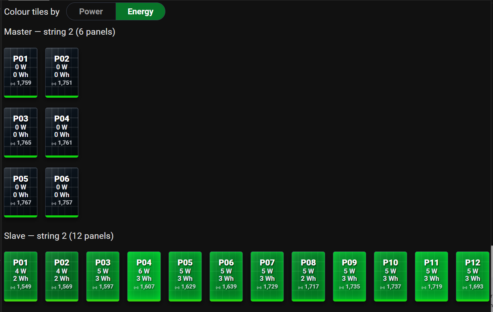

# PV Panels Dashboard

One view that shows everything PyTap knows about each panel at a glance: live power, today's energy, today's readings and the panel's data validity. Each panel is a tile laid out like the roof, and a **Colour tiles by [Power | Energy]** switch picks what the tile colour shows.



*About 08:25 on a 6 + 12 panel installation, coloured by energy. The 12-panel string has started producing; the 6-panel string faces differently and hasn't yet, so its tiles are dark. Every panel's connectivity bar (bottom edge) is green.*

This dashboard is new in this fork. It replaces the three separate views of the [classic PV Production dashboard](pv_production.md) (energy, connectivity and power), which is still available and kept up to date.

## What a tile shows

```
 P04        panel name
 312 W      live power, or its state (see below)
 1.61 kWh   today's energy
 ⦿ 1,247    today's readings
 ▔▔▔▔▔▔     connectivity bar
```

| Line | Shows | Source |
|---|---|---|
| Name | The panel's position name | the card's `name` |
| Power | Live watts (`312 W`), or the panel's state: `Asleep`, `Est.` (estimated), `Silent`, `No data`; `312 W*` while holding its last value | `_power` and `_data_validity` |
| Energy | Today's energy: `838 Wh` below 1,000 Wh, `1.61 kWh` from there | `_daily_energy` |
| Readings | Readings received today, after an antenna icon | `_readings_today` |

The W and Wh units tell power and energy apart, and the readings count has its own icon, so the tile needs no labels.

## Colours

**Tile background** — chosen with the switch at the top:

| Data validity | Colour by **Power** | Colour by **Energy** |
|---|---|---|
| Reporting or holding | Green, brighter with live power relative to the best panel now (`sensor.tigo_max_power`) | Green, brighter with today's energy relative to the best panel today (`sensor.tigo_max_daily_energy`) |
| Asleep | Dark | Green by today's energy, so the evening still shows how each panel did |
| Estimated / silent, estimated in string | Amber | Amber |
| Silent | Red | Red |
| No data (bus status not normal) | Grey | Grey |

Problems show the same way in both modes, so a silent panel is red whichever you're looking at.

**Connectivity bar** — the 4 px bar along the bottom edge goes from red to green by today's readings relative to the best panel (`sensor.tigo_max_readings_today`). A panel with half the best count is yellow; one that barely reported is red. Until any panel has reported today (from midnight until the panels wake), the bar is neutral grey.

The switch is a Home Assistant helper, so the choice is shared: switching on a phone switches every screen showing the dashboard.

## Installing

1. **Frontend cards** — install from the Marketplace on Home Assistant 2026.11+, or from HACS on earlier versions:
   - [custom:button-card](https://github.com/custom-cards/button-card) 7 or later
   - [custom:layout-card](https://github.com/thomasloven/lovelace-layout-card)
2. **Max sensors** — add [`tigo.yaml`](tigo.yaml) as described in the [classic dashboard's prerequisites](pv_production.md#prerequisites). They find your panels themselves and need no editing.
3. **Colour switch helper** — **Settings → Devices & services → Helpers → Create helper → Dropdown**, named `Tigo tile colour` (entity ID `input_select.tigo_tile_colour`) with the options `Power` and `Energy`, in that order. Or in YAML:
   ```yaml
   input_select:
     tigo_tile_colour:
       name: Tigo tile colour
       icon: mdi:palette
       options: [Power, Energy]
   ```
4. **Dashboard** — **Settings → Dashboards → Add dashboard → New dashboard from scratch**, open it, choose **⋮ → Edit dashboard → ⋮ → Raw configuration editor**, and paste [`pv_panels_dashboard.yaml`](pv_panels_dashboard.yaml).
5. **Your panels** — replace the example's entity IDs, names and grid positions with your own (see below).

## Adapting the layout

The example is a roof with two strings: **Master** with 6 panels in 3 rows of 2, and **Slave** with 12 panels in one row. Each string is a `custom:layout-card` grid of 24 columns (12 portrait panels × 2 columns), and each tile is one line:

```yaml
- { type: custom:button-card, template: pytap_panel, entity: sensor.tigo_master_s2_p01_power, name: P01, view_layout: { grid-row: 1, grid-column: 1 / 3 } }
```

- **`entity`** — the panel's **Power** sensor. The tile finds the panel's other sensors by replacing `_power` in the entity ID with `_daily_energy`, `_readings_today` and `_data_validity`, so those must keep PyTap's default IDs. Your IDs depend on your module, string and inverter names; see [Device naming](../README.md#device-naming).
- **`name`** — the label on the tile.
- **`view_layout`** — the tile's grid row and columns. A portrait tile spans 2 columns (`1 / 3`, `3 / 5`, …). For a landscape panel, span 3 columns and change the template's `aspect-ratio` to `3/2` in a copy of the template.
- Add a `heading` and a grid for each string or roof face.

All styling lives in two `button_card_templates` at the top of the file, `pytap_panel` (the tile) and `pytap_colour_option` (one half of the switch), so you only edit the panel lines.

## Classic dashboard

The [PV Production dashboard](pv_production.md) has the same tiles split into three views, each colouring the whole tile by one measure: daily energy, connectivity or power. Use it if you prefer one measure per screen, or for its Grafana version.
