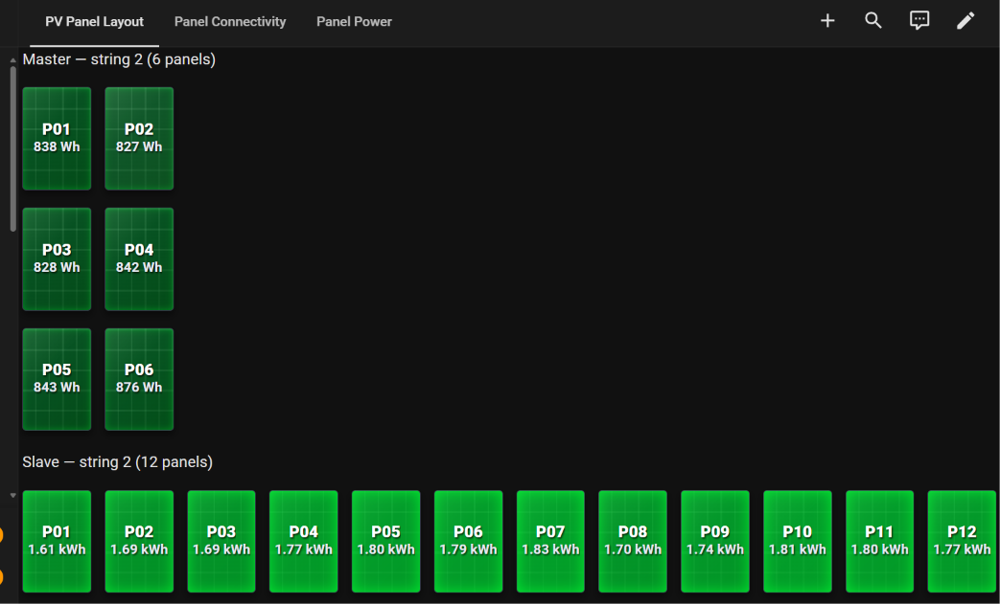
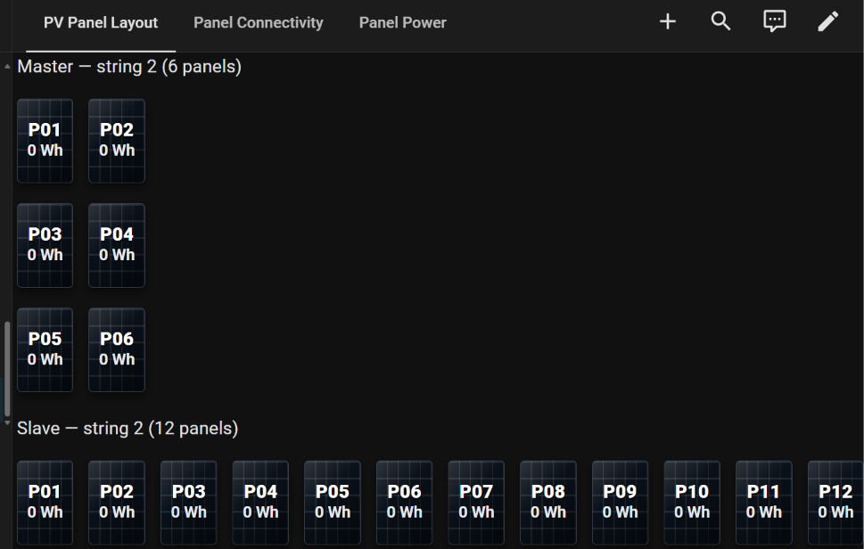
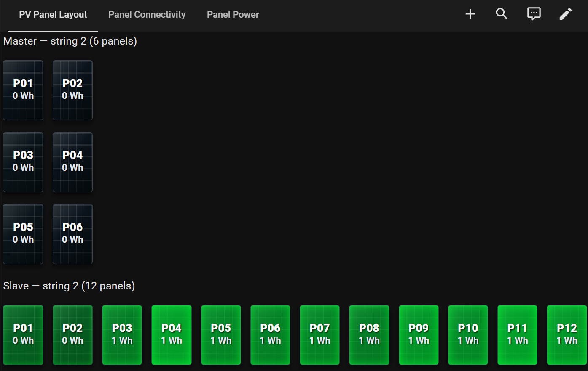
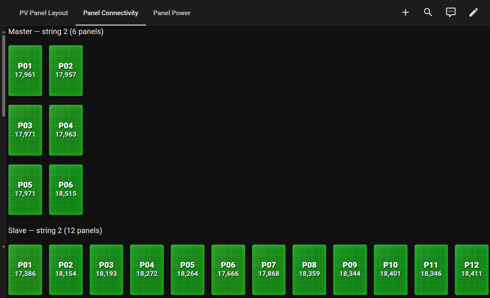
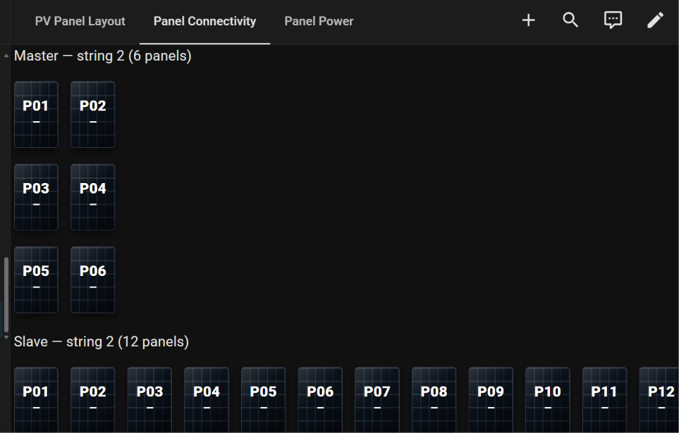
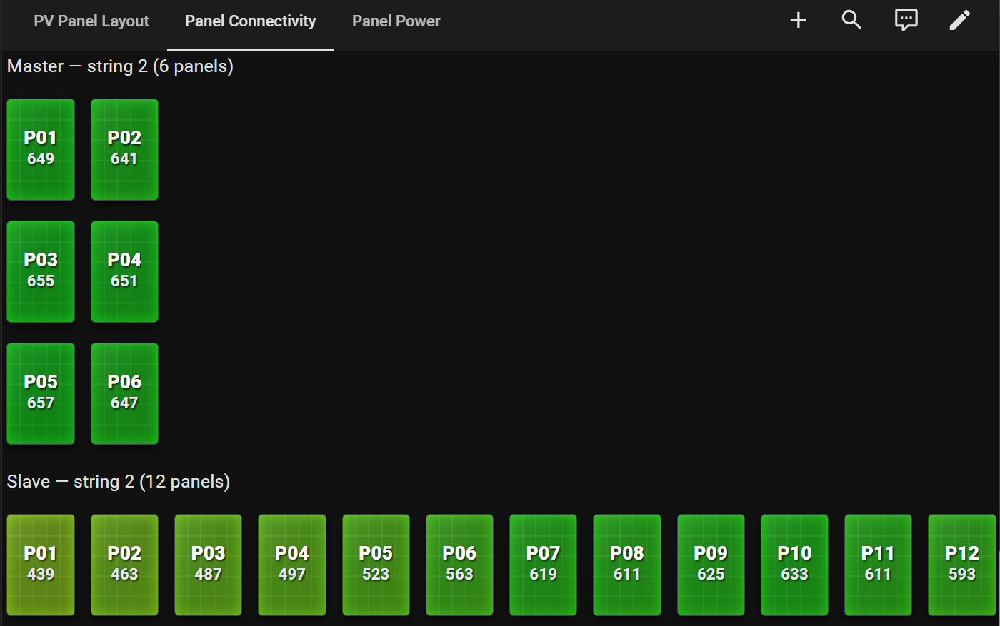
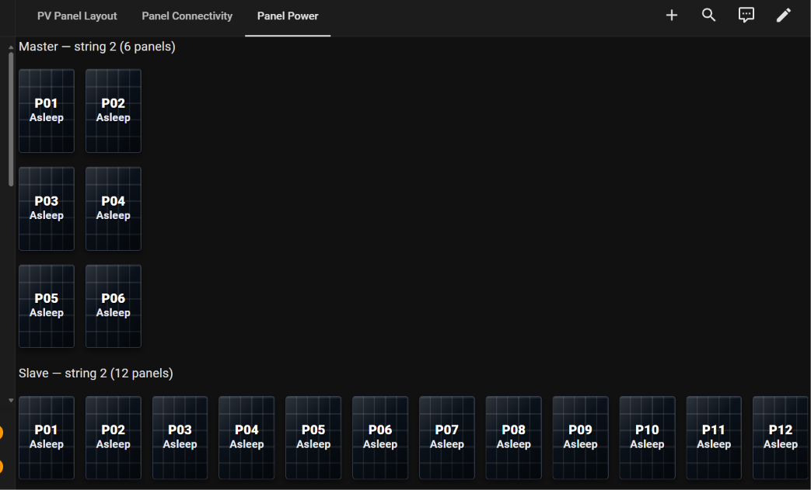
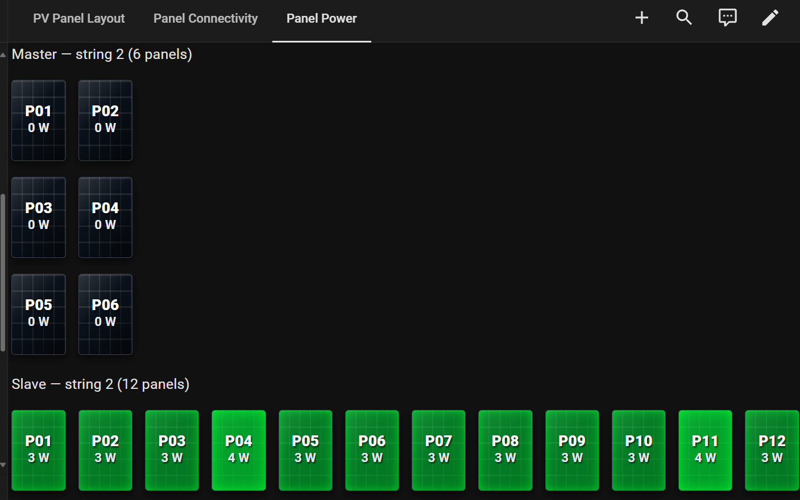

# PV Production Dashboard (classic)

Home Assistant Lovelace dashboard displaying the physical solar panel layout with dynamic status coloring, in three views: daily energy, connectivity and power.

> **New in this fork: the [PV Panels dashboard](pv_panels.md)** puts power, energy, readings and data validity on every tile in a single view, with a switch to colour the tiles by power or energy. Start there; this classic dashboard is kept and maintained for one-measure-per-view use and its Grafana version.

> **This is a worked example for one roof**, not a drop-in dashboard. It lays out 26 panels named C1–D13 and uses entity IDs such as `sensor.tigo_ts4_c1_power`, which PyTap created for modules named `C1` before version 1.4.0. On your installation the IDs depend on your module, string and inverter names (for example `sensor.tigo_s2_p01_power`; see [Device naming](../README.md#device-naming)). To use it, replace the panel entity IDs and grid positions with your own. The max sensors in `tigo.yaml` work on any installation as they are.

## Files

| File | Purpose |
|------|---------|
| [`pv_production_dashboard.yaml`](pv_production_dashboard.yaml) | Lovelace dashboard (3 views, ~1,070 lines) |
| [`pv_panels_dashboard.yaml`](pv_panels_dashboard.yaml) | The newer single-view dashboard; see [pv_panels.md](pv_panels.md) |
| [`tigo.yaml`](tigo.yaml) | HA template sensors for max-value aggregation |
| [`grafana/pv_production_grafana.json`](grafana/pv_production_grafana.json) | The same layout as a Grafana dashboard (InfluxDB v3) |
| [`grafana/generate_grafana_dashboard.py`](grafana/generate_grafana_dashboard.py) | Script that generated the first version of the Grafana dashboard |

## Prerequisites

**Frontend cards** (install from the Marketplace on Home Assistant 2026.11+, or from HACS on earlier versions):

- **[custom:button-card](https://github.com/custom-cards/button-card)** — tile rendering with JS templates for dynamic styling
- **[custom:layout-card](https://github.com/thomasloven/lovelace-layout-card)** — CSS Grid layout for precise column positioning

**Template sensors** — add `tigo.yaml` as a package (see the comment at the top of the file). It provides:

| Sensor | Entity ID | Purpose |
|--------|-----------|---------|
| Tigo Max Daily Energy | `sensor.tigo_max_daily_energy` | Highest `_daily_energy` across all panels (Wh) |
| Tigo Max Readings Today | `sensor.tigo_max_readings_today` | Highest `_readings_today` across all panels |
| Tigo Max Power | `sensor.tigo_max_power` | Highest live `_power` across all panels (W) |

They find the panels themselves (every entity on a PyTap device of model TS4), so they need no editing. They're computed server-side so each button-card only needs a single `states[]` lookup instead of scanning every panel sensor in JavaScript.

## Views

### 1. PV Panel Layout (`/pv-layout`)

Shows daily energy production per panel. Each tile displays the panel name and `sensor.tigo_ts4_<panel>_daily_energy` value, shortened to fit a portrait tile: `838 Wh` below 1,000 Wh, `1.61 kWh` from there (a shared `state_display` template, anchor `&energy_state_display`).

**Color scale:** Transparent → Green. Green overlay alpha scales from 0 to 0.7 relative to `sensor.tigo_max_daily_energy`. An inner green glow intensifies with production.



*End of a day on the same 6 + 12 panel installation. Brightness is relative to the best panel (1.83 kWh), so the 6-panel string, which produced about half as much per panel that day, shows as darker green. Differences within a string are visible too: P01 on the 12-panel string is the dimmest of its row.*



*Just after midnight: daily energy has reset to 0 Wh on every panel, so every tile is dark until the panels start producing.*



*About 07:45, as the panels start up. The 12-panel string has made its first watt-hour or so, which is already the day's maximum, so even 1 Wh shows as bright green: brightness is relative to the best panel, not absolute. The 6-panel string, facing differently, hasn't produced anything yet.*

### 2. Panel Connectivity (`/panel-connectivity`)

Shows the number of readings received today per panel using `sensor.tigo_ts4_<panel>_readings_today`.

**Color scale:** Red → Green. HSL hue scales 0° (red) → 120° (green) relative to `sensor.tigo_max_readings_today`. Low-connectivity panels are immediately visible in red. Until any panel has reported today (from midnight until the panels wake), the tiles stay dark and show `–` instead of turning red, since nothing is wrong. That's a shared `state_display` template, anchor `&conn_state_display`.



*End of a day on the same 6 + 12 panel installation: every panel received 94–100% as many readings as the best one, so all are green. A panel at half the best count would show yellow, and one that barely reported would show red.*



*Just after midnight: the readings counts have reset and no panel has reported yet, so the tiles stay dark and show `–` until the panels wake.*



*About 07:45, with 439 to 657 readings each. Panels wake at slightly different times, so early in the day the colours spread out (here P01 on the 12-panel string woke last and shows yellow-green). The spread narrows as the day's counts grow.*

### 3. Panel Power (`/panel-power`)

Shows the live power output per panel using `sensor.tigo_ts4_<panel>_power`, coloured by the panel's **Data validity** sensor (PyTap 1.4.2+), found by replacing `_power` with `_data_validity` in the entity ID:

| Data validity | Tile | Text |
|---|---|---|
| Reporting | Green, alpha 0–0.7 relative to `sensor.tigo_max_power` (at least 20 W, so ~1 W at dusk stays dark), with an inner glow | Power, e.g. `312 W` |
| Holding last value | Same green, from the held value | `312 W (held)` |
| Estimated / Silent, estimated in string | Amber | `Estimated` |
| Silent | Red | `Silent` |
| Asleep | Dark (no overlay) | `Asleep` |
| Unavailable (bus status not normal) | Grey | `No data` |



*At night, on an installation with a 6-panel and a 12-panel string (laid out to match that roof): every panel is asleep.*



*About 07:45. Every panel is reporting. The 6-panel string is awake but producing 0 W, so its tiles are dark with `0 W` rather than `Asleep`; the 12-panel string is making 3–4 W per panel, already the maximum, so it shows green.*

Without a Data validity sensor (PyTap before 1.4.2) every tile is green by power, as before. A silent panel's power sensor is unavailable, so without this colouring it looked the same as a sleeping one.

## Physical Layout

All three views mirror the actual roof panel arrangement using a 26-column CSS grid. Panels have two orientations matching real hardware:

- **Landscape (3:2)** — C2, C3 (top row) and D12, D13 (south-facing)
- **Portrait (2:3)** — all other panels

```
               col 11        col 14                           col 21
                 ┌──────────┐ ┌──────────┐                     ┌──┐
     Row 1       │  C2 (L)  │ │  C3 (L)  │                     │D12 (L)│
                 └──────────┘ └──────────┘                     └──┘
        col 9   col 11  col 13  col 15  col 17                col 21
         ┌──┐    ┌──┐    ┌──┐    ┌──┐    ┌──┐                  ┌──┐
  Row 2  │C4│    │C10│   │C9 │   │C8 │   │C7 │                 │D13 (L)│
         └──┘    └──┘    └──┘    └──┘    └──┘                  └──┘

    col 4  col 6  col 8  col 10 col 12 col 14 col 16 col 18 col 20 col 22
                   ┌──┐    ┌──┐   ┌──┐   ┌──┐   ┌──┐   ┌──┐   ┌──┐
     Row 3         │C1│    │C6│   │D6│   │D7│   │D8│   │D9│   │C11│
                   └──┘    └──┘   └──┘   └──┘   └──┘   └──┘   └──┘
     ┌──┐   ┌──┐   ┌──┐   ┌──┐   ┌──┐   ┌──┐   ┌──┐   ┌──┐   ┌──┐   ┌──┐
     │D11│  │D5│   │C12│  │D4│   │D3│   │D1│   │D2│   │C5│   │C13│  │D10│
     └──┘   └──┘   └──┘   └──┘   └──┘   └──┘   └──┘   └──┘   └──┘   └──┘
     Row 4
```

- **Top section** (`grid-layout`): Row 1 has C2/C3 centered (landscape) + D12 (landscape, south-facing, separated by spacer); Row 2 has C4, C10, C9, C8, C7 (portrait) + D13 (landscape, south-facing)
- **Bottom section** (`grid-layout`): Row 3 has C1–C11 main array; Row 4 extends left with D11/D5 and continues through D10

## Panels (26 total)

| String C       | String D       |
|----------------|----------------|
| C1, C2, C3     | D1, D2, D3     |
| C4, C5, C6     | D4, D5, D6     |
| C7, C8, C9     | D7, D8, D9     |
| C10, C11, C12  | D10, D11       |
| C13            | D12, D13       |

## Tile Rendering

Each tile is a `custom:button-card` with a layered CSS background that simulates a solar panel:

1. **Color overlay** — dynamic green (page 1) or hue-shifted (page 2) based on performance percentage
2. **Glass reflection** — diagonal gradient from white highlight to dark shadow
3. **Cell grid lines** — horizontal + vertical `repeating-linear-gradient` at 20% intervals
4. **Dark base** — `#0a111a`

A dynamic `box-shadow` adds an inner glow whose intensity and color match the performance metric.

### Page 1 color formula (Energy)

```javascript
const max = parseFloat(states['sensor.tigo_max_daily_energy']?.state) || 1;
const pct = Math.min(Math.max(val, 0) / max, 1);
const alpha = pct * 0.7;
// Green overlay: rgba(0, 220, 50, alpha)
// Inner glow:    rgba(0, 255, 50, 0.8 * pct)
```

### Page 2 color formula (Connectivity)

```javascript
const max = parseFloat(states['sensor.tigo_max_readings_today']?.state) || 0;
if (max <= 0) return base;  // no readings yet today: dark, no overlay
const pct = Math.min(Math.max(val, 0) / max, 1);
const hue = Math.round(pct * 120);  // 0°=red → 120°=green
// Color overlay: hsla(hue, 80%, 50%, 0.55)
// Inner glow:    hsla(hue, 80%, 50%, 0.7)
```

### Page 3 color formula (Power)

```javascript
const v = states[entity.entity_id.replace(/_power$/, '_data_validity')]?.state;
const max = Math.max(parseFloat(states['sensor.tigo_max_power']?.state) || 0, 20);
const pct = Math.min(Math.max(val, 0) / max, 1);
// Reporting/holding: rgba(0, 220, 50, pct * 0.7), inner glow rgba(0, 255, 50, 0.8 * pct)
// Estimated: rgba(255, 170, 0, 0.5)   Silent: rgba(220, 40, 40, 0.55)
// Asleep: no overlay                  Unavailable: rgba(120, 120, 120, 0.5)
```

The tile text comes from a shared `state_display` template (anchor `&pwr_state_display`).

## YAML Structure

YAML anchors keep the file DRY:

| Anchor | View | Orientation | Purpose |
|--------|------|-------------|---------|
| `&tile_landscape` | Energy | Landscape (3:2) | C2, C3, D12, D13 tiles |
| `&tile_portrait` | Energy | Portrait (2:3) | All other tiles |
| `&conn_tile_landscape` | Connectivity | Landscape (3:2) | C2, C3, D12, D13 tiles (red→green) |
| `&conn_tile_portrait` | Connectivity | Portrait (2:3) | All other tiles (red→green) |
| `&pwr_tile_landscape` | Power | Landscape (3:2) | C2, C3, D12, D13 tiles (by power and data validity) |
| `&pwr_tile_portrait` | Power | Portrait (2:3) | All other tiles (by power and data validity) |

All three views use the same structural approach:

1. **Top roof** — `custom:layout-card` with `grid-template-columns: repeat(26, 1fr)`, 6px gap
2. **Spacer** — blank `button-card` (20px height)
3. **Bottom roof** — second `custom:layout-card` with the same 26-column grid

Each panel card specifies its exact position via `view_layout: { grid-row, grid-column }`, with portrait tiles spanning 2 columns and landscape tiles spanning 3.

## tigo.yaml — Template Sensors

Server-side Jinja2 template sensors that take the highest value across all panels. Each one selects the PyTap optimizer entities by device model and entity ID suffix, so no entity IDs are listed:

```yaml
template:
  - triggers:
      - trigger: time_pattern
        minutes: "/1"
      - trigger: homeassistant
        event: start
    sensor:
      - name: "Tigo Max Daily Energy"   # sensor.tigo_max_daily_energy, Wh
        state: >
          
          {{ values | max if values else 0 }}
      # Tigo Max Readings Today and Tigo Max Power follow the same pattern
      # with the _readings_today and _power suffixes.
```

They are trigger-based and recalculate once a minute: as plain template sensors they recalculated after each panel sensor updated, so one PyTap update could write several in-between values to the database. A minute is plenty for scaling tile colours.

This offloads the max-value computation from the frontend (previously each of the 78 button-cards scanned all 26 sensors in JS) to a single HA template sensor that updates automatically. Unavailable or unknown panels are skipped.
