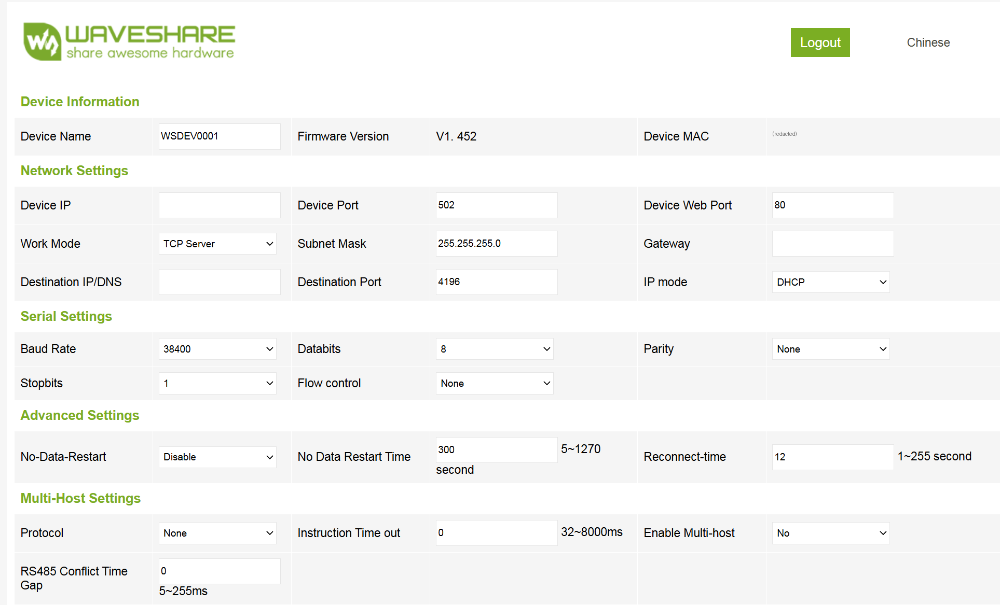

# Hardware

[← PyTap README](../README.md)

PyTap reads the RS-485 bus between your Tigo CCA and its TAP(s). It only listens: it never transmits, so the CCA and Tigo's cloud keep working as before. You need one way onto the bus, and one PyTap entry, per CCA.

## Ways to connect

| Connection | What it is | Choose when adding PyTap |
| --- | --- | --- |
| **RS-485 to TCP converter** | A small network box (Ethernet or Wi-Fi) wired to the bus, such as a [Waveshare RS485 to Ethernet](#example-waveshare-rs485-to-ethernet-converter). The most common setup. | *RS-485 to TCP converter*: its IP address and port |
| **Serial RS-485 adapter** | A USB (or other serial) RS-485 adapter on the Home Assistant host, when the host is near the CCA. | *Serial port or ESPHome serial proxy*: pick the port |
| **ESPHome serial proxy** | An ESPHome device with `serial_proxy` and an RS-485 module next to the CCA, connected to Home Assistant over the network. | *Serial port or ESPHome serial proxy*: pick the proxy |

Serial ports and proxies are opened at 38400 baud, 8N1; PyTap never changes DTR/RTS and never transmits. One port can be used by only one PyTap entry. Serial and ESPHome connections need Home Assistant 2026.11 or later (from [Tim Laing](https://github.com/timlaing)'s upstream [PR #36](https://github.com/azebro/pytap/pull/36)). For background on the bus, see [taptap](https://github.com/willglynn/taptap#connecting).

## Wiring

Connect the converter or adapter to the CCA's **GATEWAY** terminals, the same ones the TAP uses:

| CCA GATEWAY terminal | Converter terminal |
| --- | --- |
| A | A (sometimes labelled A+ or 485+) |
| B | B (sometimes labelled B- or 485-) |
| – (ground) | GND, if the converter has one |
| + | **Not connected.** This powers the TAPs; power the converter from its own supply or PoE. |

- Keep the converter's wires short, or move the CCA's A and B wires to the converter and run new wires from it to the CCA.
- The bus is already terminated at the CCA and at the last TAP. If your converter has a termination resistor (a jumper, DIP switch or setting, usually 120 Ω), **turn it off**.

### Example: Waveshare RS485 to Ethernet converter

Waveshare's RS485-to-Ethernet converters work well. Open the converter's web page (its IP address in a browser) and set:

| Setting | Value | Why |
| --- | --- | --- |
| Work Mode | **TCP Server** | PyTap connects to the converter. |
| Device Port | **502** | PyTap's default port. Any port works if you enter the same one in PyTap. |
| IP mode | DHCP with a reservation on your router, or Static | PyTap connects by address, so it must not change. |
| Destination IP/DNS, Destination Port | (ignored) | Only used in client modes. |
| Baud Rate | **38400** | Speed of the Tigo gateway bus. |
| Databits / Parity / Stopbits | **8 / None / 1** | |
| Flow control | **None** | |
| No-Data-Restart | **Disable** | PyTap reconnects by itself when data stops. |
| Protocol | **None** | Raw passthrough. Modbus conversion would corrupt the Tigo frames. |
| Enable Multi-host | **No** | |

When you add PyTap, enter the converter's IP address as the **host** and its Device Port as the **port**.
